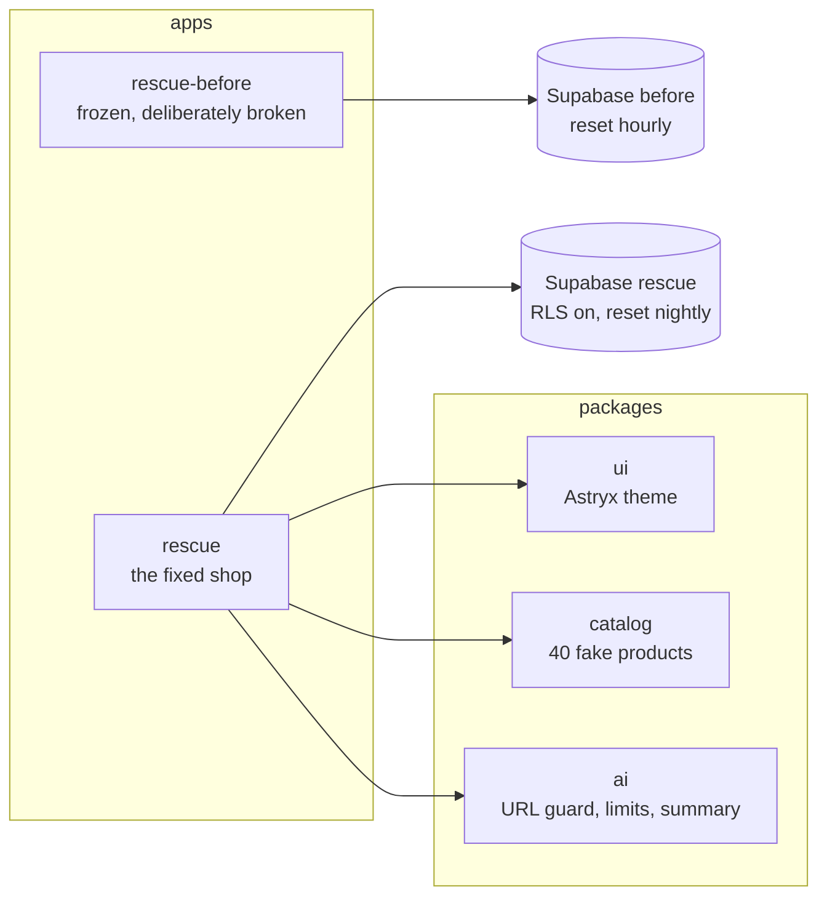

# Workshop

Live, working proof of how I build and fix web apps. Everything here runs on fake data.

**Project 1: Northfold Outfitters, an app rescue.** A typical AI-built shop, side by side with the same shop after nine fixes. Try to break both.

- Live demo: https://okafor-workshop-rescue.vercel.app (the before shop: https://okafor-workshop-rescue-before.vercel.app)
- Rescue report: https://okafor-workshop-rescue.vercel.app/report · the frontend view: https://okafor-workshop-rescue.vercel.app/report?focus=frontend
- Built by [Promise Okafor](https://promise-okafor.vercel.app) · [GitHub](https://github.com/theolodocoder)

## What this proves

- **Finding and fixing security holes** in a Next.js and Supabase app: database row-level security, secrets kept off the browser, prices set on the server, every input checked.
- **Making a slow app fast**: server rendering, images sized for each screen, a self-hosted font and less JavaScript, measured with Lighthouse rather than guessed.
- **Making it usable for everyone**: real buttons and links, keyboard support, screen-reader labels and readable contrast, checked by axe on every page.
- **Building for real conditions**: loading, empty and error states, a database that may be asleep, and safe handling of URLs that visitors paste in.
- **Working like a senior engineer**: one fix per commit, a test for each fix that fails on the before shop and passes on the rescued one, and CI on every push.

## Before and after

| | Before | After |
|---|---|---|
| Another shopper's order | Opens | Blocked by row-level security |
| Secret keys | Read in browser code | Server only, scanned for in CI |
| Prices | Taken from the browser | Set by a database function |
| Errors | Blank page | Clear message and Retry |
| Keyboard and screen readers | Clickable divs | Real controls, axe-checked |
| Security headers | None | Nonce-based CSP, HSTS and more |
| Main content on a phone (LCP) | 17.1 s | 3.7 s |
| Layout shift (CLS) | 0.51 | 0.04 |
| Accessibility problems (axe, serious + critical) | 17 | 0 |
| Tests | None | Unit, database and end-to-end in CI |

Measured 2026-11-11 with Lighthouse 12.6 (Lighthouse CI on GitHub Actions, mobile, simulated throttling, median of 5 runs on `/c/tents` of each live site). All the numbers, including the ones that didn't change, are on the [rescue report](https://okafor-workshop-rescue.vercel.app/report). A script writes them from the Lighthouse runs. They are never typed in by hand.

## How it's built



- **Monorepo:** pnpm workspaces and Turborepo. `apps/` holds what people open, `packages/` holds shared code.
- **Stack:** Next.js 16 (App Router), React 19, TypeScript, Astryx (Meta's open-source design system, MIT), Supabase (Postgres, Auth, row-level security), Zod, Playwright with axe, Vitest, Lighthouse CI, GitHub Actions. Cloudflare Workers AI and Google PageSpeed power the "check your site" page.
- **The story is in the history:** `rescue-before` is frozen at the tag `before-frozen`. `rescue` starts as an exact copy, and each fix after that is its own commit.
- **Decisions and walk-throughs:** `docs/decisions/` and `docs/explainers/` (one per milestone, with diagrams).

## Run it

You need Node 24, pnpm and Docker.

```bash
pnpm install
pnpm db:start && pnpm db:reset        # two local Supabase stacks
pnpm --filter rescue build && pnpm --filter rescue start            # http://localhost:4310
pnpm --filter rescue-before build && pnpm --filter rescue-before start  # http://localhost:4311
```

Tests:

```bash
pnpm turbo run lint typecheck test    # lint, types, unit tests
pnpm test:db                          # security rules, checkout, daily limits
pnpm --filter rescue e2e              # end to end, accessibility, headers, speed
```

## Credits

Built on Astryx (MIT, by Meta). Product photos are free photos from Unsplash (see `/about` for every photographer). Northfold Outfitters is not a real shop, and all products, prices and shoppers are made up.
