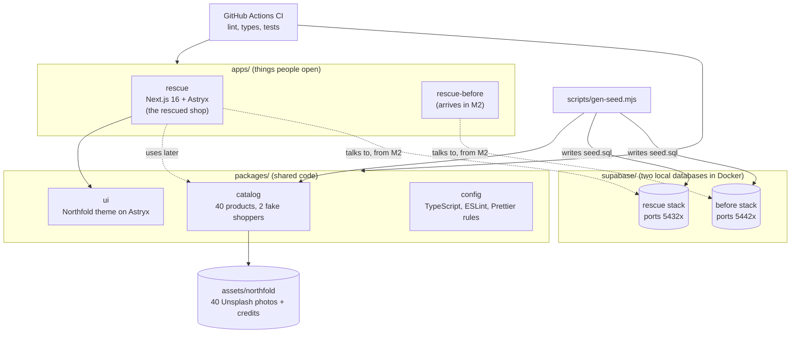

# M0 explainer: how the workshop repo is wired

*Written 2026-11-10, after milestone M0 (4 commits, `829fd62`..`976696e`).*

## 1. The picture



## 2. The walk-through (say this on a call)

> "It's one repo with two kinds of folders. `apps` holds what people actually open, and `packages` holds code the apps share. pnpm workspaces link the packages together, so the shop imports the theme and the product catalog like normal npm packages. Turborepo runs lint, type checks and tests across everything in the right order, and caches the results.
>
> The look comes from Astryx, Meta's open-source design system. I didn't fork it. I extend its neutral theme with one brand color in a small `ui` package, so every app gets the same look from one place.
>
> All the demo data is fake and lives in one `catalog` package: 40 outdoor products with credited Unsplash photos, and two made-up shoppers. A script turns that catalog into SQL seed files, so the databases can never drift from what the app thinks the products are.
>
> There are two local Supabase stacks running in Docker, one for the broken 'before' shop and one for the rescued shop. They start identical. Later, only the rescued one gets the security fixes, and you can watch the same attack work on one and fail on the other."

## 3. Decisions and what I turned down

| Decision | Why | Turned down |
|---|---|---|
| **pnpm workspaces + Turborepo** | Five small apps need linking, caching and task order, and Turborepo does that with one small `turbo.json`. | **Nx.** I ran Nx at JobWhisper with 11 apps, where its generators and project graph paid off. Here it's more setup than the repo needs. |
| **Astryx in "dist" mode** (pre-built CSS + JS), copied from Meta's own Next.js example | No extra build plugin and no Next.js features switched off, so it's the most boring setup that works. | The StyleX compiler setup. It's only needed when we write custom StyleX styles, and we can add it later. |
| **Theme = `defineTheme({ extends: neutralTheme })` with one accent** | We inherit every Astryx token and override only what's ours. Astryx stores light and dark as `light-dark(#2F6B4F, #6FBF95)`. | Ejecting (forking) the theme, which means maintaining a full copy of Meta's theme forever. |
| **`ui` package has React as a *peer* dependency** | When it installed its own React, Next.js loaded two copies and the build crashed (`Cannot read properties of null (reading 'useContext')`). | Bundling React into the package. That's a classic monorepo bug, and the fix is "one React, owned by the app". |
| **Two Supabase stacks, not one** | The before/after story needs the same tables with different security. Two stacks keep them fully separate, just like production will be. | One database with two schemas: easier to run, but less honest, since a fix could leak into the "before" side. |
| **Seed SQL generated from the catalog** | One source of truth for products and prices. | Hand-written SQL, which would drift from the app's product list. |
| **Photos at 1600px, product-only, free Unsplash license** | Heavy enough to make the slow shop slow, light enough for git (22 MB), and no real people in the photos. | 2000px (34 MB, over our 30 MB limit), and Unsplash+ photos (paid license). |
| **TypeScript 6.0, not 7.0** | TS 7 is the new Go-based compiler, and our lint tooling (typescript-eslint) only supports up to 6.0 today. | Upgrading now and fighting tool breakage. |
| **Astryx's install script switched off** | I read it first. It only prints a "run astryx init" hint. Not running unknown install scripts is a good default. | Approving every install script blindly. |

## 4. Questions a client might ask

**"Why a monorepo for a demo?"**
Because that's how real products grow: a web app, an admin and a desktop app that share one design system and one data model. I set one up from the first commit at JobWhisper (11 apps, 19 packages). This is the same idea at the right size.

**"Why not Nx?"**
Nx is great at scale. It gives you generators, a project graph and affected-only CI. For five small apps, Turborepo's caching and task order cover what matters, with far less config. I'd move to Nx if the repo grew into dozens of projects.

**"How do you keep the design consistent across apps?"**
Every app wraps itself in the same `northfoldTheme` from `packages/ui`. Changing a token there changes every app at once.

**"Is any of this data real?"**
No. The products, prices and the two shoppers (Ada and Ben) are made up, and the photos are free Unsplash photos credited to their photographers. Every reset wipes visitor data and puts the seed back.

**"What happens when Astryx releases a new version?"**
Versions are pinned exactly. Astryx's own `upgrade` command moves core and theme together, since a theme is built against one exact core release. We upgrade on purpose, with tests running.

## 5. How to try it on your machine

```bash
cd ~/Desktop/Workspaces/prodev/workshop
pnpm install
pnpm turbo run lint typecheck test     # everything should pass
pnpm db:start                          # needs Docker Desktop running
pnpm test:db                           # both databases seeded: 6 tests pass
pnpm --filter rescue build && pnpm --filter rescue start
```

Then open http://localhost:4310. For now you'll only see "Northfold Outfitters" and a green "Shop gear" button. That's the Astryx spike proving the theme works. The real shop screens wait for your mockup approval in M1.

Database dashboards (Supabase Studio): http://localhost:54323 (rescue) and http://localhost:54423 (before).
