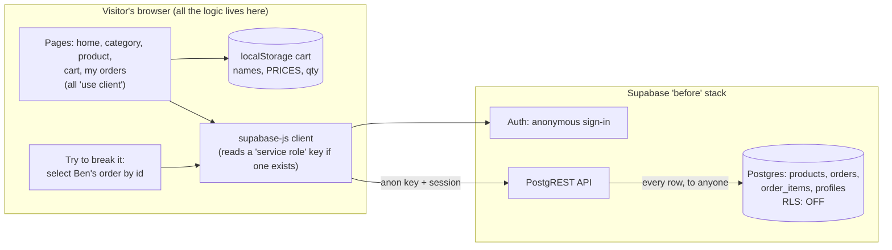

# M2 explainer: the "before" shop

*Written 2026-11-10, after milestone M2. This app is now frozen (git tag `before-frozen`).*

## 1. The picture



The key point: **nothing stands between the browser and the tables.** Supabase gives each table a public API. Without row-level security (RLS), that API returns any row to anyone holding the public key, and the public key is meant to be public.

## 2. The walk-through (say this on a call)

> "This is the shop the way I often find client apps that were built quickly or with AI tools. It looks fine and it works: you can browse, add a tent, check out and see your order. But all the logic lives in the browser.
>
> The cart, prices included, sits in localStorage, and checkout writes whatever total the browser computed. The database has no row-level security, so the 'My orders' page only *asks nicely* for your own orders. Change the query and you get everyone's. The 'Try to break it' button does exactly that: it asks for Ben's order by its id, and the database hands it over.
>
> Pages fetch data after they load, push full-size 1600-pixel photos to phones, and load a charting library on every page for one tiny decoration. Buttons and links are clickable `div`s, so keyboard and screen-reader users can't use the shop at all.
>
> I wrote every one of these on purpose, labelled in the code, so the rescue can fix them one commit at a time."

## 3. The nine planted problems

| # | Where in the code | What an AI builder does | Why it's dangerous |
|---|---|---|---|
| 1 | `supabase/before/.../20261110000001_shop.sql` (no RLS) | Creates tables and moves on | The public API returns **every row to anyone**: other people's orders, addresses, anything |
| 2 | `src/lib/supabase.ts` | Uses the service-role key in browser code "so queries just work" | That key skips all security. Anyone who opens dev tools owns the database. (Our deployed copy only ever holds a dummy, so the pattern shows without the danger.) |
| 3 | `src/lib/cart.ts`, `src/app/cart/page.tsx` | Keeps prices in localStorage and writes the browser's total | Edit one number in dev tools and you set your own price |
| 4 | Every page (`setX(data!)`, `.single()` with no catch) | Assumes the network never fails | One failed request means a blank page with no message and no retry |
| 5 | Quantity `<input>` on the product page | Accepts any number | `0`, `-3` and `9999` all go into the cart and the order |
| 6 | The whole app | Writes no tests | Every fix risks breaking something else, and nobody finds out until a customer does |
| 7 | `useEffect` fetches, raw ``, `recharts` in `Header.tsx` | Fetches everything client-side, uses full-size images, imports big libraries anywhere | Slow first paint, huge downloads on phones, extra JavaScript on every page |
| 8 | `div onClick` everywhere, missing `alt` and labels, grey text | Builds controls from divs | Keyboard and screen-reader users can't shop. It also fails accessibility rules like the EAA |
| 9 | `next.config.ts` (no headers) | Ships the defaults | No CSP or HSTS, so the site can be framed and has no protection against injected scripts |

## 4. Decisions and what I turned down

| Decision | Why | Turned down |
|---|---|---|
| **Use Astryx for the look, but plain `div`s for the controls** | It *looks* like a real product, which is the point: AI-built apps usually look fine. | Making it ugly. A client wouldn't recognise their own app in it. |
| **Self-contained app** (copies the theme and constants, imports no `@workshop/*` package) | It's frozen. Later upgrades and the design-system reskin can never accidentally "fix" it. | Sharing packages, which would make the before shop drift as the repo changes. |
| **"Try to break it" is one component, copied unchanged into the rescued shop** | Same code, same request, different database rules. That proves the fix lives in the database, not in hiding a button. | Two different buttons, which would be a weaker demonstration. |
| **Anonymous sign-in per visitor** | No sign-up wall, and each visitor's cart and orders are their own. | One shared demo account, which would let visitors see each other's orders even in the rescued shop. |
| **Problem 2 is real code with a dummy deployed value** | A real service-role key in a public site would hand strangers the whole project. | Shipping a working key "because it's a demo". It could still get the free project abused or paused. |

## 5. Questions a client might ask

**"Isn't the anon key a secret?"**
No. Supabase's anon (publishable) key is meant to be in the browser. What protects your data is row-level security. Without it, the anon key is enough to read every table. The service-role key is the real secret, and it must never reach the browser.

**"Why not just hide Ben's order in the UI?"**
Because the attacker doesn't use your UI. They call the API directly, the way the "Try to break it" button does. The fix has to live in the database.

**"How common is this really?"**
Very common in quickly built apps, because the app works perfectly in testing until someone looks. That's why I start every rescue by checking access rules first.

**"How do you know the fixes work?"**
Each fix gets a test that **fails on this frozen shop and passes on the rescued one**. That's the rescue report you'll see in M5.

## 6. How to try it

```bash
cd ~/Desktop/Workspaces/prodev/workshop
pnpm db:start                                    # Docker running
pnpm --filter rescue-before build && pnpm --filter rescue-before start
```

Open http://localhost:4311:
1. Click **Sign in as a demo shopper** (top right).
2. Open **Tents**, then **Summit Light Tent**, then **Add to cart**.
3. Go to **Cart** and click **Place order**. Your order shows on **My orders**.
4. On **My orders**, click **Try to open Ben's order**. It opens, with Ben's tent, sleeping bag and stove.

Try pressing Tab to reach the buttons: you can't. That's problem 8.
