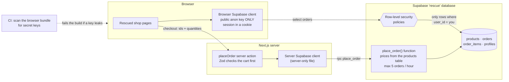

# M3 explainer: the security fixes

*Written 2026-11-10, after milestone M3 (commits `601feb7`..`b6dde1e`). Fixes 1, 2, 3 and 5 are done.*

## 1. The picture



## 2. The walk-through (say this on a call)

> "The first thing I check in any rescue is who can read and write what. Here the answer was 'anyone, anything'. So I did four things.
>
> **One:** I turned on row-level security for every table. Postgres now checks each row against a rule before returning it, and the rule for orders is 'only if it's yours'. The 'Try to break it' button runs the exact same query as before, and now gets zero rows.
>
> **Two:** I removed the service-role key from the browser. The browser only gets the public key, which is designed to be public, because the rules from step one are what protect the data. A check in CI scans the built JavaScript and fails the build if a secret key ever shows up again.
>
> **Three:** I moved pricing to the server. The browser now sends only product ids and quantities. A database function looks up each price itself, writes the order, and refuses a sixth order in the same hour. I tested it by editing the price in the browser to one cent: the order still costs $429.
>
> **Four:** every input is checked with Zod before it's used. Quantities have to be 1 to 10, the cart has 1 to 20 lines, and product ids have a length limit. Bad input gets a clear message instead of a weird order."

## 3. Each fix, with its proof

| Fix | Code | Test that proves it (fails on before, passes here) |
|---|---|---|
| **1. Row-level security** | `supabase/rescue/.../20261110000002_rls.sql` | `supabase/tests/rls.test.ts`: A can't read, change or delete B's order. A can read their own. Anyone can read products, and nobody can change them. Plus e2e `break.spec.ts`, which now shows **Blocked** |
| **2. No secrets in the browser** | `apps/rescue/src/lib/supabase/{browser,server}.ts`, `scripts/check-client-secrets.mjs` | The scanner's tests, plus real proof: building the old code with the local service key set gave `SECRET IN CLIENT BUNDLE: service_role JWT`. After the fix, the same build is clean |
| **3. Server-priced checkout** | `supabase/rescue/.../20261110000003_place_order.sql`, `apps/rescue/src/app/cart/actions.ts` | `place-order.test.ts` (database prices win over browser prices; bad carts are rejected; the 6th order in an hour is refused; direct inserts are gone) and `session.spec.ts` (a price edited in the browser still costs $429.00) |
| **5. Validate every input** | `apps/rescue/src/lib/schemas.ts` | `schemas.test.ts` (10 cases) and `validation.spec.ts` (0, -3 and 9999 are refused with a message, and nothing goes into the cart) |

## 4. Decisions and what I turned down

| Decision | Why | Turned down |
|---|---|---|
| **Lock everything, then open only what's needed** (RLS on all 4 tables) | A table you forget about stays locked instead of open | Adding rules table by table as problems show up |
| **`(select auth.uid())` inside policies** | Postgres works out the shopper's id once per query instead of once per row. It's Supabase's own performance advice. | Plain `auth.uid()`, which is slower on big tables |
| **A temporary "insert your own orders" rule in fix 1, removed in fix 3** | Every commit keeps the shop working, so the history reads as a clean sequence | Breaking checkout between two commits |
| **Pricing in a `security definer` Postgres function** | The price check sits right next to the data, and no client can skip it, whether that's the website, a script or a future mobile app | Pricing only in the Next.js server action. That's safe for this site, but any other client could still write orders directly |
| **Rate limit inside the same function** | A demo visitor can't flood the free database | A separate rate-limit service, which is more moving parts for a demo |
| **Zod on the server, plus the same schema in the browser for messages** | One definition drives both the friendly message and the real guard | Checking only in the browser, which an attacker simply skips |
| **Sessions in cookies (`@supabase/ssr`)** | Server code can see who the shopper is, so server actions and server rendering (M5) work | localStorage sessions, which only the browser can read |

## 5. Questions a client might ask

**"Is row-level security enough on its own?"**
It's the most important layer, because it protects the data no matter which client asks. But it isn't the only one. Pricing and limits live in a server-side function, inputs are validated, and the service key never leaves the server. Defence in layers means one mistake doesn't expose everything.

**"Doesn't RLS slow the database down?"**
Barely, when it's written well. The policies use an index on `orders.user_id` and work out the shopper's id once per query. On large tables I'd check the query plans.

**"Why can the public key be in the browser?"**
It's designed for that. It only grants what your RLS rules allow. The service-role key skips RLS entirely, so it must stay on the server. The CI scan makes sure it does.

**"How would you do this on a client's existing app without breaking it?"**
The same way I did here. First, tests that show the hole, like the "Try to break it" test. Then the rules, one table at a time. Then I move writes behind server functions, keeping the app working at every commit. The git history of this repo shows that order.

**"What did you use Supabase for before?"**
Be honest: "I used it here, in this project." The skills carry over from Postgres and API security work, and this repo is the proof.

## 6. How to try it

```bash
cd ~/Desktop/Workspaces/prodev/workshop
pnpm db:start && pnpm db:reset        # applies the new rules to the rescue database
pnpm test:db                          # 25 database tests, including the security ones
pnpm --filter rescue build && pnpm --filter rescue start
```

Open http://localhost:4310 (the rescued shop):
1. Sign in as a demo shopper, add a tent, check out. It works as before.
2. On **My orders**, click **Try to open Ben's order**. It's **Blocked**.
3. On a product page, type `0` or `9999` in the quantity box and click Add to cart. You get a clear message.

Then compare with the before shop on http://localhost:4311, where the same click opens Ben's order.

*Still to come in M4:* the rescued shop still uses clickable divs, has no error states and sends no security headers. It also still shows the "Deliberately insecure demo" banner, which changes when the real header and home are built in M5.
