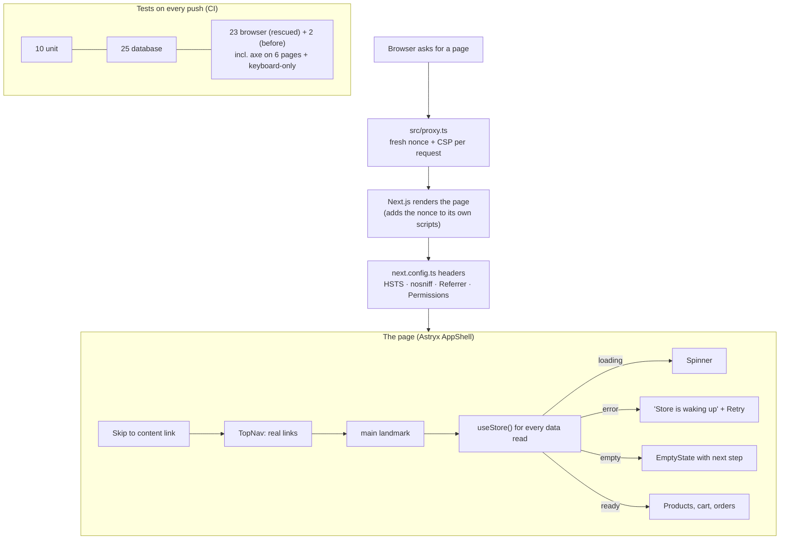

# M4 explainer: the quality fixes

*Written 2026-11-10, after milestone M4 (commits `7ee03cb`..`d585120`). Fixes 4, 6, 8 and 9 are done, and the shop now uses the approved Astryx design.*

## 1. The picture



## 2. The walk-through (say this on a call)

> "After security, I made the shop hold up when real people and real networks are involved.
>
> **Every data read goes through one small hook**, so every page has three states besides success: a spinner while loading, a friendly 'store is waking up' message with a Retry button when the database doesn't answer, and an empty state that tells you what to do next. Unknown products get a real not-found page, and anything unexpected lands on an error page instead of a white screen.
>
> **Accessibility:** I rebuilt the controls on Astryx, using the mockups we approved. Real buttons, real links in a labelled navigation, a skip link, a main landmark, described photos and labelled fields. An automated axe scan runs on every page in CI, and a keyboard-only test proves you can tab from the top of the page to 'Add to cart' and press Enter.
>
> **Security headers:** every page gets a Content-Security-Policy with a fresh random nonce, so the browser only runs scripts we sent in that response. An injected script is refused. There's also HSTS, no MIME sniffing, a strict referrer policy and no clickjacking.
>
> **Tests:** the whole flow is covered end to end, from browsing to adding two things, changing a quantity, removing one and checking out, and the order shows the server's total. CI starts both databases in Docker and runs everything."

## 3. Each fix, with its proof

| Fix | Code | Proof |
|---|---|---|
| **4. Error, loading and empty states** | `src/lib/useStore.ts`, `src/components/StoreStates.tsx`, `app/{error,loading,not-found}.tsx` | `errors.spec.ts`: with the database cut off, you see "Store is waking up" and Retry, and no crash text, and Retry recovers once the database is back. Also covered: no orders, signed out, unknown product, empty cart. Checkout failures (rate limit, bad cart, store down) each get a clear banner |
| **6. Tests** | `apps/rescue/e2e/*.spec.ts`, `.github/workflows/ci.yml` | `flows.spec.ts` covers the full journey. 23 browser tests pass three runs in a row, and CI runs database, unit, browser and secret-scan checks |
| **8. Keyboard and screen readers** | `src/components/{Shell,DemoSignIn,ProductCard,CategoryTabs,CartLineRow}.tsx` | `a11y.spec.ts`: axe finds **0 serious or critical problems** on 6 pages. Before the fix it found up to 50 contrast problems, 40 photos without descriptions and an unlabeled field. Also checked: keyboard-only Tab to "Add to cart", then Enter, and every product photo has a description |
| **9. Security headers** | `src/proxy.ts`, `next.config.ts` | `headers.spec.ts`: CSP with a nonce, `frame-ancestors 'none'`, HSTS for 2 years, nosniff and the referrer policy. Each page view gets a different nonce, and the whole shop works under the policy with no CSP errors |

## 4. Decisions and what I turned down

| Decision | Why | Turned down |
|---|---|---|
| **One `useStore` hook for every read** | The three non-happy states are written once and look the same everywhere | Handling errors page by page, which is how the before shop ended up with none |
| **Keep supabase-js's built-in retries** (3 retries, about 8 s) before showing "waking up" | Free databases sleep, and a short wait usually beats an error | Failing fast. The cost: a real outage takes about 8 s to show |
| **Astryx AppShell for the page frame** | It brings the skip link and the main landmark for free, as its docs require, so we don't roll our own | A hand-written skip link, which would duplicate the landmark |
| **A labelled native number field for quantity** | Astryx's NumberInput only updates on blur, which could race the "Add to cart" click | A custom stepper |
| **CSP from Next.js's own `proxy.ts` pattern** with nonce + `strict-dynamic` for scripts | It's the documented way. Next.js stamps the nonce on its own scripts | A static CSP with `'unsafe-inline'` scripts, which blocks almost nothing |
| **Styles allow `'unsafe-inline'`** | React `style={…}` attributes can't carry a nonce. Scripts are the real XSS risk | A full nonce on styles, which would mean rewriting every inline style |
| **`upgrade-insecure-requests` only in production** | Locally the database is plain http, and the header would break it | Always on |
| **Every page renders per request** | A nonce must be new for each request | Static pages. Trade-off: we can't prerender, so M5's speed numbers will show the real cost and the real gains |
| **Decorative chart is `aria-hidden` + `inert` for now** | It stays until fix 7 removes it, so each fix is its own commit | Deleting it here and muddling the speed fix |

## 5. Questions a client might ask

**"What does a CSP nonce actually protect against?"**
Cross-site scripting. If an attacker gets a `<script>` into your page, for example through a comment field, the browser won't run it, because it doesn't carry this response's secret nonce.

**"How do you test accessibility?"**
Three ways. Automated axe scans on every page in CI. A keyboard-only test of the main flow. And by hand with a screen reader before release. Automation catches about half of real problems, so the manual pass still matters.

**"Your pages show a spinner while loading. Isn't that slow?"**
For now, yes, because the data still loads in the browser. That's planted problem 7, and M5 fixes it: pages render on the server, so the products arrive with the HTML.

**"How do you keep tests from being flaky?"**
I ran the suite three times in a row and fixed what wobbled. One tab component sometimes renders a duplicate link, so tests pick the first visible one. Tests use real roles and labels, the way a user or screen reader finds things, not CSS classes.

## 6. How to try it

```bash
cd ~/Desktop/Workspaces/prodev/workshop
pnpm db:start && pnpm db:reset
pnpm --filter rescue build && pnpm --filter rescue start
```

Open http://localhost:4310:
1. Press **Tab** once: "Skip to content" appears. Keep tabbing through the menu and products, then press Enter on one.
2. On a product, try quantity `0`: you get a clear message. Add one, go to **Cart**, change the quantity, remove a line, and place the order.
3. Stop the database (`pnpm db:stop`) and reload the shop. After a few seconds you see **Store is waking up** and **Retry**. Start it again (`pnpm db:start`) and click Retry.
4. In the browser dev tools Network tab, open the page request: the `content-security-policy` header shows a new `nonce-…` each time you reload.
