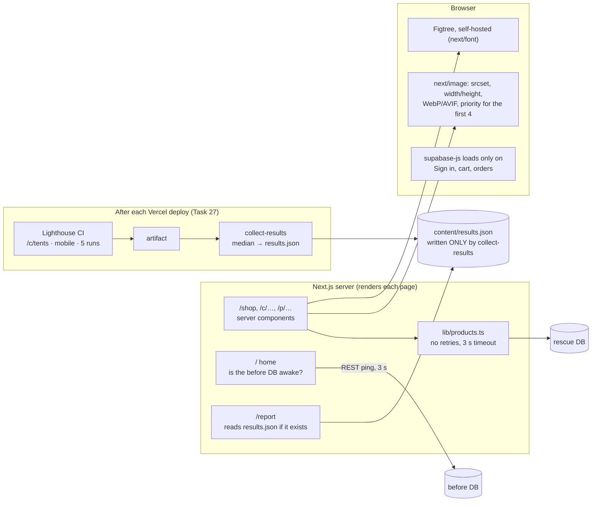

# M5 explainer: speed, measured results and the rescue report

*Written 2026-11-10, after milestone M5 (commits `02a3ae6`..`2fa01bc`). Fix 7 is done, all nine fixes are in, and the site now has its two-door home and its report.*

## 1. The picture



## 2. The walk-through (say this on a call)

> "Speed was the last fix, and I measured it rather than guessing.
>
> The product pages now render on the server, so the products arrive with the HTML. You can switch JavaScript off and still see the tent and its price. Photos go through Next's image pipeline: each phone gets a size that fits its screen in a modern format, and every image reserves its space, so nothing jumps. The theme font is self-hosted. The charting library that loaded on every page for one squiggle is gone. The database client only downloads when you actually sign in, and the browser no longer downloads a validation library just to check a quantity, because the server still does the real check with Zod.
>
> I also made sure a sleeping free database can't freeze a page. The server gives up after three seconds and shows 'store is waking up' with a Retry button, and a test proves the page answers in under six seconds even when the database never replies.
>
> The rescue report lists all nine fixes, each with its risk, its fix, its commit and the test that proves it. There's a frontend view that puts speed and accessibility first. The before/after numbers only appear once real Lighthouse runs on the deployed sites have produced them. Until then the page honestly says 'Not measured yet'."

## 3. What changed, with proof

| Change | Code | Proof |
|---|---|---|
| **Server rendering** | `src/lib/products.ts`, `app/shop`, `app/c/[category]`, `app/p/[slug]` | `speed.spec.ts`: product and category content shows **with JavaScript blocked** |
| **Sized, modern images** | `ProductCard.tsx`, `ProductDetail.tsx` (`next/image`) | `speed.spec.ts`: every photo has `srcset`, `width` and `height` |
| **No chart library** | `TrendSparkline` removed, `recharts` uninstalled | `speed.spec.ts`: no script on `/shop` contains `recharts` |
| **Supabase client only when needed** | `DemoSignIn.tsx` (imported on click), `layout.tsx` (reads the session cookie) | The `/shop` page no longer loads supabase-js |
| **Self-hosted font** | `layout.tsx` (`next/font` Figtree), `packages/ui` font tokens | The font is served from our own domain with a matched fallback |
| **Can't hang on a sleeping DB** | `lib/supabase/server.ts` (`retry: false`, 3 s timeout) | `store-down.spec.ts`: "Store is waking up" shows in under 6 s on 3 pages, and Retry asks again |
| **Two-door home** | `app/page.tsx`, `HomeDoors.tsx`, `lib/before-health.ts` | `home.spec.ts`. Also `store-down.spec.ts`: when the before database is asleep, its door says so |
| **Rescue report** | `app/report/page.tsx`, `content/fixes.ts`, `FixCard`, `ResultsTable` | `report.spec.ts`: 9 cards, security first by default, Fix 7 first with `?focus=frontend`, "Not measured yet" with no file, "Link after release" for unpublished commits. `report-measured.spec.ts` checks the numbers against a clearly labelled test file |
| **Measured numbers pipeline** | `lighthouserc.json`, `.github/workflows/lighthouse.yml`, `scripts/collect-results.mjs`, `e2e-tools/axe-count.mjs` | `collect-results.test.ts`: the median of 5 runs, a schema-checked output, and it **refuses to write anything without real runs** |

**My local spot check (phone screen, uncompressed, not for publishing):** on `/c/tents`, JavaScript went from 1,234 KB to 928 KB and images from 4,932 KB to 494 KB. On the tent's product page, images went from 364 KB to 29 KB. The axe count on `/c/tents` went from 17 serious or critical problems to 0. **These go nowhere public.** The report will show the Lighthouse numbers from the deployed sites, with the method and date.

## 4. Decisions and what I turned down

| Decision | Why | Turned down |
|---|---|---|
| **Server components for the catalog pages; cart and orders stay client-side** | The catalog is what search engines and Lighthouse see. Cart and orders belong to one shopper and change constantly | Rendering everything on the server, which is more work for little gain here |
| **No retries + a 3 s timeout on the server** | One slow database shouldn't block a whole page. The browser still retries its own calls | Waiting the library's default of about 8 s |
| **A second test server pointed at a dead database** | Server-side fetches can't be intercepted from the browser, so this tests the real thing | Mocking the database in unit tests only |
| **The home page asks the before database directly** | It tells us whether the before shop works without touching the frozen app | Adding an `/api/health` route to the before app, which would mean unfreezing it |
| **The browser uses a tiny quantity check; Zod stays on the server** | It saves the browser about 29 KB gzipped, and both read the same limits from `lib/limits.ts` | Shipping Zod to the browser for one message |
| **Lighthouse on `/c/tents`, mobile, median of 5** | It's the page with the most images and the clearest story, and the median smooths out noise | A single run, or every page (slower CI, same story) |
| **Budgets are warnings, not failures** | We publish what we measure, whatever it is | Failing the build until numbers look good, which nudges toward chasing scores |
| **TBT is shown as the "lab stand-in for INP"** | Lighthouse can't measure INP without real users | Calling TBT "INP" |
| **Every page renders per request** (from M4's nonce) | Security wins here. It costs some speed, and the numbers will show it honestly | Static pages without a nonce CSP |

## 5. Questions a client might ask

**"What made the biggest difference?"**
Images, by far. The before shop sent full 1,600-pixel photos to phones. Next/image now sends a fitting size in WebP or AVIF, and reserves the space. After that, rendering on the server, so content arrives with the HTML, and dropping JavaScript nobody needed.

**"How do I know your numbers aren't cherry-picked?"**
They come from Lighthouse CI on the deployed sites: mobile, 5 runs, median. A script writes them, and the page shows the method and date. If there's no measurement, the page says "Not measured yet". The budgets only warn, so a bad number gets published, not hidden.

**"Why is your JavaScript still around 900 KB uncompressed?"**
Most of it is React and the design system's components. Compressed, it's a fraction of that. The next steps would be trimming which Astryx components each page pulls in, and moving more UI to server components. That's a trade-off I'd talk through with a client.

**"What happens when the free database is asleep?"**
The shop shows "Store is waking up" within a few seconds instead of hanging, and Retry asks again. The home page notices when the before shop's database is asleep and says so instead of sending visitors to a broken page.

## 6. How to try it

```bash
cd ~/Desktop/Workspaces/prodev/workshop
pnpm db:start && pnpm db:reset
pnpm --filter rescue build && pnpm --filter rescue start      # rescued, http://localhost:4310
pnpm --filter rescue-before start                             # before, http://localhost:4311 (separate terminal)
```

1. Open http://localhost:4310: the two-door home. The before door opens :4311.
2. Open **Rescue report**, then add `?focus=frontend` to the address: speed and accessibility come first.
3. On `/c/tents`, open the browser dev tools and go to Network, then Img: the photos are small WebP or AVIF files. Compare with :4311/c/tents.
4. Turn off JavaScript (dev tools, Settings, Debugger) and reload a product page: the content is still there.
5. Run `pnpm db:stop` and reload `/` and `/shop`. The before door says it's asleep, and the shop shows **Store is waking up** within a few seconds.
