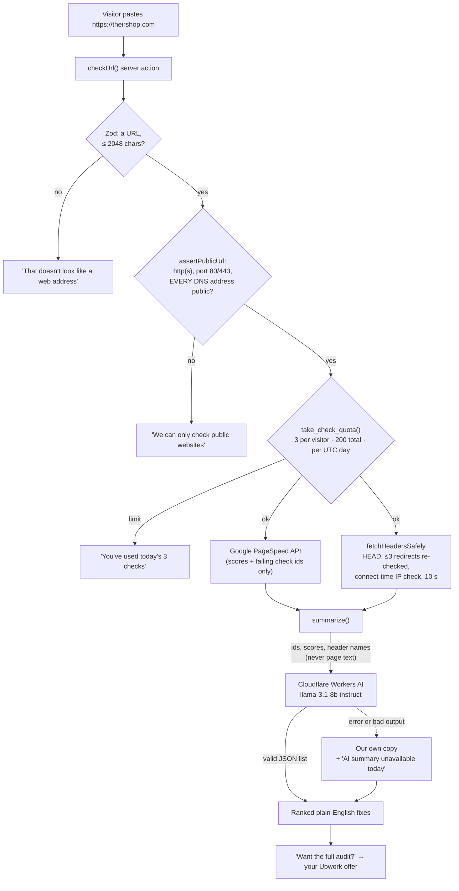

# M6 explainer: the "check your site" feature

*Written 2026-11-10, after milestone M6 (commits `299cbbb`..`2634b55`).*

## 1. The picture



## 2. The walk-through (say this on a call)

> "Any feature where a visitor gives your server a URL to fetch is a classic attack surface. It's called server-side request forgery. Someone pastes `http://169.254.169.254` and your server politely reads its own cloud credentials. So the check is built guard first.
>
> The address must be http or https on a normal port, and **every** address its name resolves to must be public. No localhost, no private networks, no cloud metadata. Redirects are followed by hand and checked again at every hop. And the actual connection checks the IP once more at connect time, so a domain that switches to an internal address between the check and the request is still refused. I tested that against a real domain that points at 127.0.0.1.
>
> Then a database function hands out today's checks: 3 per visitor, 200 for everyone, so the free tiers survive. Only after that do we call Google's PageSpeed API and read the site's security headers.
>
> The AI only sees numbers and check names, never text from the visitor's page, so nobody can hide instructions in their site to steer it. If the AI is down or answers in the wrong shape, you still get the list in our own words, with a note saying so."

## 3. What's in it, with proof

| Piece | Code | Proof |
|---|---|---|
| **SSRF guard** | `packages/ai/src/safe-url.ts` | 23 unit tests (loopback, private ranges, link-local and metadata, CGNAT, IPv6 including `::ffff:` mapped in both forms, bad schemes and ports, names resolving to *any* private address, redirect to metadata, redirect limit). Real-network checks: example.com works, localhost is refused, and a fooled DNS pre-check (`localtest.me`) is still refused at connect time |
| **Daily caps** | `supabase/.../20261110000004_check_quota.sql`, `packages/ai/src/quota.ts` | `quota.test.ts`: 3 per visitor, resets the next UTC day, global 200 cap, and counters can't be read or edited directly. `visitorHash` is salted SHA-256 and never stores the raw IP |
| **PageSpeed** | `packages/ai/src/pagespeed.ts` | Unit test: keeps only scores and failing check ids by weight. A fake check title containing `<script>` is dropped |
| **Headers** | `packages/ai/src/headers.ts` | Unit test: CSP, HSTS, nosniff, referrer policy and frame protection, reported as yes or no |
| **AI summary** | `packages/ai/src/summarize.ts`, `workers-ai.ts` | Unit tests: the prompt has no `<` or `http` and no page text. Valid AI output is used. Bad, long or failed output falls back to our own copy |
| **The page** | `apps/rescue/src/app/check/*`, `CheckForm.tsx` | `check.spec.ts` (against local mocks of Google and the AI): result list with an audit link, internal addresses refused, bad text, the 4th check refused, and AI down still showing results. axe finds 0 serious problems on `/check` |

## 4. Decisions and what I turned down

| Decision | Why | Turned down |
|---|---|---|
| **Check the IP at connect time, not just before** | It closes the DNS-rebinding gap between "check" and "fetch" | A check before fetching only, which is the most common SSRF bug |
| **undici's own `fetch` + `Agent`** | Node's built-in fetch rejects an Agent from the newer undici package (I hit this and verified it) | Hoping the versions match |
| **HEAD request, headers only** | We never download the visitor's page body | GET and parse the HTML, which means more data, more risk and more to explain |
| **Take the quota before any outbound call** | Refused checks cost nothing, so abuse can't run up Google or AI usage | Counting after the work |
| **No `day` parameter on the quota function** | A caller can't pass another date to dodge the cap | A day parameter for easier testing (tests move rows back a day instead) |
| **Visitors don't need to sign in** | Less friction for a client trying it | Requiring sign-in. The trade-off: someone could burn the shared 200 a day, and the worst case is the check pausing until tomorrow |
| **AI sees ids and numbers only, and must answer in a strict shape** | No prompt injection from the visitor's site, and no surprise output | Sending page text "for better answers" |
| **Our own plain-English copy as the fallback** | The feature still works with no AI at all | An error page when the AI fails |
| **Mocks for Google and the AI in browser tests** | Tests are fast, free and deterministic. The headers step still reads real public sites | Calling the real APIs in CI |

## 5. Questions a client might ask

**"What's SSRF and why does it matter?"**
When your server fetches a URL a user gave it, they can point it at things only your server can reach, like internal admin pages or cloud credentials. Plenty of real breaches started this way. The defence is to allow only public addresses, check every redirect, and check again when the connection is made.

**"Can someone trick your AI through their website?"**
No. The AI never sees their page. It gets scores and check names like `total-blocking-time`, and it must answer in a fixed JSON shape, or we use our own wording.

**"What does it cost to run?"**
Nothing on free tiers. Google's PageSpeed API is free with a key, and Cloudflare Workers AI has a free daily allowance. The 3-per-visitor and 200-per-day caps keep it there.

**"Could this work in my product?"**
Yes. The guard, the quota and the "AI with a safe fallback" pattern are separate pieces in `packages/ai`, ready to reuse anywhere a user gives you a URL or you add an AI summary.

## 6. How to try it, and your setup checklist

Without keys, `/check` still validates and refuses internal addresses. It then says "The check isn't available right now", because it needs Google's key for the real test.

**To run it for real, create two free keys** (only you can do this; don't paste them in chat):

1. **Google PageSpeed Insights API key**
   - Go to https://console.cloud.google.com, create a project (e.g. "workshop"), then go to **APIs & Services** and click **Enable APIs**.
   - Search for "PageSpeed Insights API" and click **Enable**.
   - Go to **APIs & Services → Credentials → Create credentials → API key**. Then **Restrict key** to the PageSpeed Insights API only.
2. **Cloudflare Workers AI**
   - Sign up or log in at https://dash.cloudflare.com and copy your **Account ID** (shown on the account home or Workers page).
   - Go to **My Profile → API Tokens → Create Token** and use the **Workers AI** template (read and run). Copy the token.
3. Add them to `apps/rescue/.env.local` (this file is git-ignored and never committed):
   ```
   PAGESPEED_API_KEY=...
   CF_ACCOUNT_ID=...
   CF_AI_TOKEN=...
   CHECK_SALT=any-long-random-text
   ```

Then:
```bash
cd ~/Desktop/Workspaces/prodev/workshop
pnpm db:start && pnpm db:reset
pnpm --filter rescue build && pnpm --filter rescue start
```
Open http://localhost:4310/check and try your portfolio, `https://promise-okafor.vercel.app`. A real Google test takes about 15 to 40 seconds. Then try `http://localhost:4310` and `http://169.254.169.254`: both are refused. On the 4th try, you've used today's checks (`pnpm db:reset` clears them).
