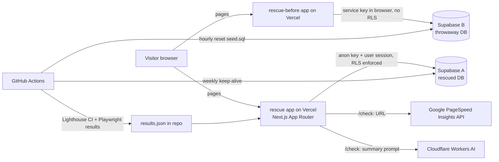

# Workshop: design (2026-11-10)

Status: DRAFT, reviewed by a builder check, waiting for Promise's approval. Nothing is built.
Covers: (A) how we work, (B) the services this proves, (C) the `workshop` monorepo, (D) project 1 in full, (E) projects 2 to 5 in outline (each gets its own design talk when its turn comes).
Related: `../UPWORK-RESEARCH-AND-PROJECTS.md` (research). Facts about Promise come only from `../../_FACTS.md`.

---

## Why this exists

Promise's best work is private company work (JobWhisper closed in Nov 2026, he left Zabira in Nov 2026, and his Cosella work belongs to his current employer), so Upwork and Fiverr clients have nothing live to click. Workshop is a set of small, live, deployed projects that prove he can do the jobs clients actually post. They must also be things **he can explain on a client call as his own decisions**: every piece ships with an explainer he can say out loud.

## A. How we work (agreed with Promise)

- **Who decides what.** Claude makes the engineering calls (libraries, file layout, naming, tests, code). Promise decides anything that changes what a client sees, costs money, is hard to undo, or changes his story: names and branding, the look (mockup approval), v1 scope, and every word that goes public. Claude asks those as multiple-choice questions with a recommended answer. Claude does not stop for anything else.
- **One project at a time, each a full loop:** design → plan → build in small commits → explainer pack → Promise tests locally → Promise says go → push, deploy, add to the portfolio. Then the next project.
- **Explainer pack after every finished piece** (milestone or project): (1) a diagram of the parts and how data moves, (2) a plain walk-through he could say on a call, (3) the why behind each decision, with the alternatives turned down, (4) "questions a client might ask, and your answers". These live in the repo under `docs/explainers/` and grow into each project's README "How it's built" section.
- **Commits:** small, one change each, plain messages he can explain. No Claude or AI co-author lines (OSS rule). Nothing is pushed, deployed or posted until Promise has tested it locally and said yes.
- **UI rule:** before building any screen, look for inspiration, show a mockup, and get Promise's approval.

## B. Services this proves (from 100 Upwork job posts, 2026-11-10)

On Nov 10 the newest 100 posts for "react" and "next.js" ([react search](https://www.upwork.com/nx/search/jobs/?q=react&per_page=50&sort=recency), [next.js search](https://www.upwork.com/nx/search/jobs/?q=next.js&per_page=50&sort=recency)) broke down roughly like this:
- ~35 build or extend a SaaS/MVP (mostly "full-stack", React/Next.js + Supabase/Node)
- ~12 finish, fix or rescue an existing app and launch it
- ~12 AI features or AI products
- ~7 code review or audits (security, quality, often Supabase)
- ~6 sites from designs
- ~4 React Native launch
- **0** pure speed jobs

This is a one-day snapshot, not a statistic. Service order for his profile: (1) SaaS frontend builds, (2) "finish, fix and launch your app", (3) AI features, (4) a code + security + speed audit as the cheap first step, (5) Figma/designs to Next.js, (6) design systems, Electron and React Native as specialist extras.

**Project order (Promise, 2026-11-10):** 1 App rescue demo → 2 Ops console → 3 AI sidebar → 4 Design system on Astryx → 5 Electron desktop shell.

## Goals, non-goals, anti-goals

- **Goals:** each project is live on a public URL, opens without sign-up, and has a 30-second video moment. Each proves one service above. Promise can explain every part.
- **Non-goals:** real customers, real payments, a polished e-commerce product, Lighthouse-score chasing for its own sake.
- **Anti-goals** (a failure even if it works):
  - anything Promise can't explain
  - any invented number (only measured results, with the method stated)
  - any real person's data
  - copying or looking like a real brand (that's why the shop isn't "Ridgeline", a real NZ outdoor brand)
  - claiming Supabase or anything else as past client work when it was only used here
  - a deliberately insecure demo that can actually hurt someone

## Constraints

- Free tiers only: Vercel Hobby (non-commercial, fine for demos), Supabase free (2 projects; a project pauses after a stretch without activity, so a weekly keep-alive ping is needed), Cloudflare Workers AI (free daily allowance), GitHub Actions on a public repo. Check current limits at build time.
- Look and feel: Meta's Astryx (`@astryxdesign/core`, MIT, React 19 + StyleX, beta v0.7.x). Pin exact versions. Credit "Built on Astryx (MIT, by Meta)". Never use Meta's name, logo or the Astryx wordmark as our branding. Until project 4, use the `neutral` theme plus a small outdoor accent made with `defineTheme`.
- Data: seeded fake data only, labelled "Demo store, not a real shop".

## C. The `workshop` monorepo

- **Repo:** `theolodocoder/workshop` (public once Promise says go). **Deploy names:** `okafor-workshop-<project>.vercel.app`.
- **Tooling (Claude's call):** pnpm workspaces + Turborepo. Why: 5 small apps don't need Nx's weight, and Turborepo's caching covers what matters. Story for calls: "I ran Nx at 11 apps; for five, Turborepo was enough."
- **Layout:**
```
workshop/
  apps/
    rescue-before/   # project 1, the frozen "AI-built" version
    rescue/          # project 1, the rescued version (starts as a copy of rescue-before)
    console/         # project 2 (+ project 3's AI sidebar inside it)
    desktop/         # project 5, Electron wrapper around console
    ui-docs/         # project 4, Storybook + theme studio
  packages/
    ui/              # Astryx theme + our extra components (grows in project 4)
    catalog/         # Northfold product seed data + images manifest
    ai/              # shared AI client, per-visitor daily cap, prompt helpers
    config/          # shared tsconfig, eslint, prettier
  supabase/          # migrations, seed.sql, RLS policies (per project schema)
  docs/
    explainers/      # the explainer packs
    decisions/       # one short file per decision, the "why" record
  .github/workflows/ # CI: lint, typecheck, unit, e2e, Lighthouse CI, keep-alive, hourly reset
```
- **CI on every push:** lint, typecheck, Vitest, Playwright (with axe), Lighthouse CI on the rescue apps. CI must pass before Promise is asked to test.

## D. Project 1: Northfold Outfitters, the app rescue

**Message (Promise):** a client finishes the video thinking **"he'd fix my half-built app."** Offer it proves: *"I'll finish, fix and launch your app"*, plus the audit as the first step.

### What a visitor sees
1. **Home** (`okafor-workshop-rescue.vercel.app`): one line ("A typical AI-built shop, before and after a rescue") and two doors: "Open the before shop" (links to `okafor-workshop-rescue-before.vercel.app`) and "Open the rescued shop".
2. **Both shops:** home, category, product page, cart, "My orders", sign-in. Same 40 Northfold products (tents, packs, boots...). A "Sign in as a demo shopper" button (no typing passwords).
3. **"Try to break it":** one button that, as demo shopper A, asks for demo shopper B's order. On *before* it shows B's order. On *rescued* it's refused. This is the opening shot of the video.
4. **Rescue report** (rescued app, `/report`): one card per problem with: what could go wrong for the business (plain words), the fix, a link to the exact commit, and the test that proves it.
5. **Side-by-side numbers** (`/report`): measured speed (LCP, INP, CLS), accessibility issue count, bundle size, test count, before vs. after, with how and when they were measured. Filled from CI, never typed in by hand.
6. **Paste-your-URL check** (`/check`): a visitor pastes their site's address. The server gets Google's PageSpeed Insights report and reads the public response headers. AI writes a short ranked list in plain words: speed, accessibility, missing security headers. It ends with "Want the full audit?", linking to his Upwork offer. Limited to 3 checks per visitor per day.

### Problems planted in "before" (and fixed in "rescued")
| # | Problem (what clients post about) | Fix in rescued |
|---|---|---|
| 1 | No row-level security, so any signed-in user can read and change other users' orders | RLS policies per table, plus a test that shopper A can't read B's order |
| 2 | Service-role key used in browser code | Key only on the server, browser uses the anon key, plus a check in CI that fails if the secret appears in client bundles |
| 3 | Prices trusted from the browser at checkout | Server recomputes totals from the database |
| 4 | One failed request blanks the page | Error boundaries, loading and empty states, retry |
| 5 | No input validation | Zod on every server action and route |
| 6 | No tests | Vitest units, Playwright flows (sign-in, cart, checkout, my orders), axe on every page |
| 7 | Huge images and client-only data fetching | `next/image`, server components, route-level code splitting, `next/font` |
| 8 | Keyboard and screen-reader blockers | Labels, focus states, real buttons, contrast, skip link |
| 9 | Missing security headers | CSP, HSTS, X-Content-Type-Options, Referrer-Policy via middleware/config |

The rescued app starts as a commit that copies `rescue-before`. Then **each fix is its own commit (or short series)**, so the git history is the rescue story and the report links to it.

### Safety of the deliberately broken app
- **No working secret key ever ships in public.** A real service-role key in a public bundle gives anyone full control of the project, so problem 2 is shown, not live: the "before" code reads a key the way AI-built apps do, but the deployed value is a dummy, and the rescue report shows the pattern and the CI check that catches it. The **live** hole on "before" is problem 1 (RLS switched off on `orders` and `profiles`), reached with the normal anon key. That is the most common real-world Supabase mistake, and its damage stays inside fake demo tables.
- `rescue-before` has its **own Supabase project** with only fake data, **reset every hour** by a scheduled GitHub Action that drops and recreates the demo schema from migrations + `seed.sql` (so it survives anything a visitor changes), and also clears anonymous auth users. If the project is ever abused hard enough to be paused, the "before" door shows a recorded clip instead. That is an accepted failure mode, since it can't touch anything real. A banner says "Deliberately insecure demo. Fake data, resets hourly."
- The URL check guards against misuse: http(s) only, blocks private and internal IP ranges and redirects to them (SSRF), 10-second timeout, no fetching of page bodies beyond headers, 3 per visitor per day, a global daily cap.

### Architecture


**Stack:** Next.js (App Router), React 19, TypeScript, Astryx + StyleX, Supabase (Postgres, Auth, RLS), Zod, Vitest, Playwright + axe-core, Lighthouse CI, Cloudflare Workers AI (called over its REST API from a Next.js route), Google PageSpeed Insights API.

**Promise's setup tasks** (accounts Claude can't create): GitHub repo, Vercel account link, two Supabase projects, a free Google API key for PageSpeed Insights, a Cloudflare account and Workers AI token. Each one comes as a short checklist when it's needed.

### Milestones (each ends with an explainer pack and a local test by Promise)
1. **M0 Repo skeleton:** monorepo, tooling, CI, Astryx installed, empty apps. Explainer: how the monorepo is wired.
2. **M1 Design:** inspiration + mockup of the shop and report pages in the Astryx look. Promise approves.
3. **M2 Before shop:** working "AI-built" shop with the 9 planted problems and Northfold seed data.
4. **M3 Rescue, security:** fixes 1, 2, 3, 5 plus their tests, and the "try to break it" button.
5. **M4 Rescue, quality:** fixes 4, 6, 8, 9.
6. **M5 Rescue, speed:** fix 7, Lighthouse CI, the measured numbers on `/report`.
7. **M6 URL check:** `/check` with the guards and caps.
8. **M7 Ship prep:** README, the video script, portfolio item text (shown to Promise), deploy after his go.

Estimated 5 to 6 working days.

### What it maps to
- **Upwork:** a lead Catalog offer reworked as "Code, security and speed audit for your Next.js / React app" plus a "Finish and launch your app" offer. Proposal templates for the "finish/fix/launch" and audit posts.
- **Fiverr:** Gig 1 (fix bugs and speed up) and Gig 2 (SaaS/MVP).
- **Profile wording:** Supabase appears only as "built and secured on Supabase" in this project, never as client work (Promise, 2026-11-10).

## E. Projects 2 to 5 (outline only, own design talk later)
- **2 Ops console** (`apps/console`): SaaS back office with a 100k-row table, live feed, approvals, roles, ⌘K. AI inside the normal UI (plain-English filters, flags on odd rows, draft approval notes). Plain Astryx theme.
- **3 AI sidebar** (inside console): streaming answers, tool calls with real queries, citations that open the rows, charts in answers.
- **4 Design system on Astryx** (`packages/ui`, `apps/ui-docs`): custom brand theme, 5 to 8 extra components, theme studio, Figma overlay, "describe your brand" theme generation, agent docs. Reskins projects 1 to 3.
- **5 Electron shell** (`apps/desktop`): console with notifications, tray badge, global AI command bar, offline cache, auto-update (full on Windows; Mac needs paid signing, so Mac gets an "update available" prompt).

## Builder-check answers (Claude's calls, 2026-11-10)
- **Sign-in:** each visitor gets their own Supabase *anonymous* session ("you are a demo shopper"), so carts and orders don't mix between visitors. Two seeded shoppers ("Ada" and "Ben", fake) own the target orders that "Try to break it" goes after. Both apps use the same model.
- **Rescued app writes:** checkout is fake (no payment step). Orders are rate-limited per session at the database, and the rescued project is also reset nightly, keeping the seeded shoppers.
- **`rescue-before` is frozen after M2 and self-contained:** its own copy of the catalog data and styles, no `packages/*` imports, so later upgrades and project 4's reskin never touch it. Commit links in the report point at the public repo after Promise's go. No history rewriting after that.
- **Measuring:** Lighthouse CI on Vercel *preview* deployments of both apps, mobile profile, median of 5 runs. INP can't be measured in a lab run, so the report shows TBT labelled "lab stand-in for INP". CI uploads the results as an artifact, and a release script writes them into `apps/rescue/results.json` in a normal commit Promise reviews (no bot commits). Whatever is measured gets published, even if unimpressive. Pass bars: zero serious or critical axe issues on rescued (hard fail), and Lighthouse budgets as warnings, not failures.
- **URL check caps:** a small table in the rescued Supabase project keyed by a hashed session cookie + IP (3 a day) and a global daily counter. Evading the per-visitor cap is an accepted risk, since the global cap protects the free tier. If the AI allowance runs out, `/check` still shows the ranked results without the AI summary. Shared logic lives in `packages/ai`.
- **Prompt safety:** only structured data goes to the AI (scores, audit IDs, header present or missing), never raw text from the pasted site. The "full audit" button points to a placeholder until the Upwork offer exists (M7).
- **Astryx risk (Promise, 2026-11-10):** M0 starts with a spike that runs Astryx on Next.js + Vercel. If it fights back, keep Astryx and copy Meta's own `apps/example-nextjs` setup exactly, even if builds get slower or a Next.js feature is switched off (budget: up to 1 extra day). No lookalike fallback.
- **Vercel:** Promise's personal account (he already hosts `promise-okafor.vercel.app`). `rescue` and `rescue-before` are separate Vercel projects, each rebuilding only when its own folder or its packages change.

## Calls Claude made (check these)
- pnpm + Turborepo instead of Nx.
- Two apps (`rescue-before`, `rescue`) instead of one app with flags, so the git history tells the rescue story.
- Two Supabase projects, the "before" one throwaway and reset hourly.
- Cloudflare Workers AI over REST from Next.js on Vercel (no separate Worker deploy).
- Results on `/report` come from a CI-written JSON file, never typed in.
- 3 URL checks per visitor per day.
- Unsplash photos downloaded into the repo with credits on an About page (originals in `before`, optimized in `rescued`).
